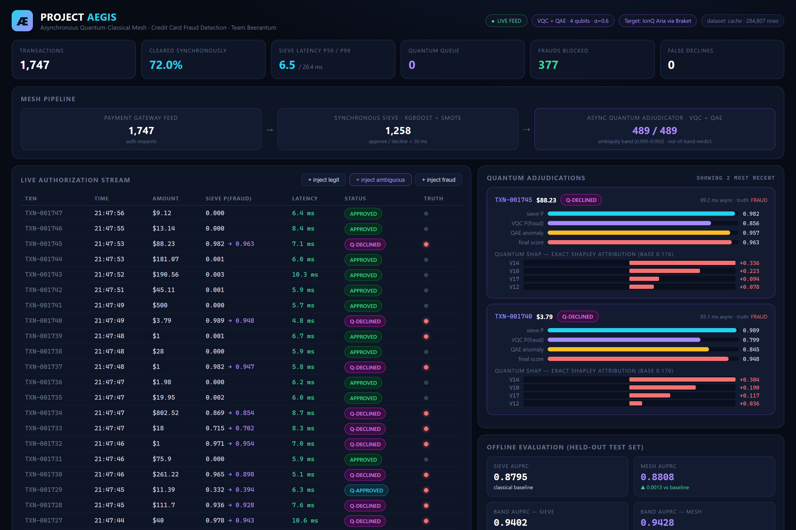
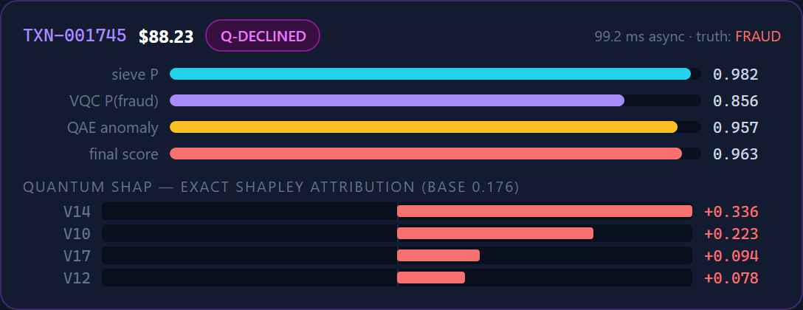
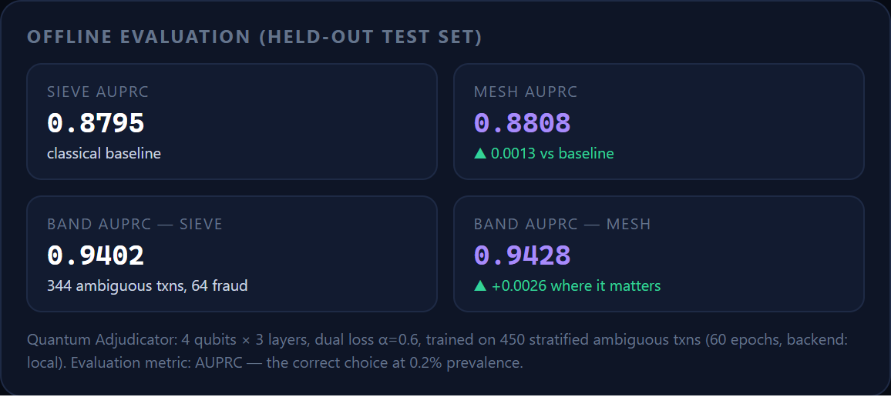
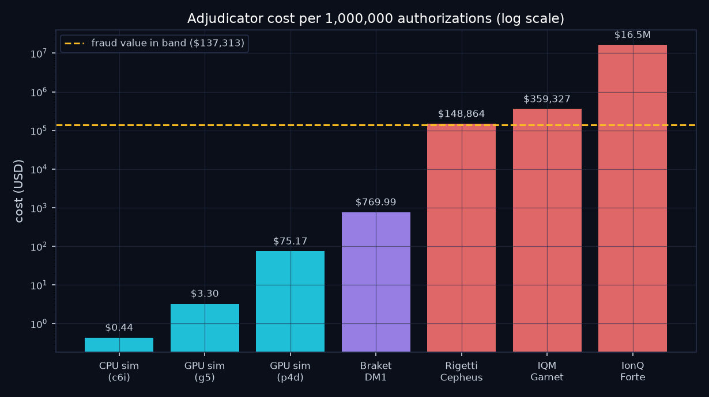

# Project Aegis

Hybrid quantum-classical credit card fraud detection that keeps quantum inference off
the synchronous authorization path.

Team Beerantum — HSBC Enterprise Challenge, 2026 Global Quantum + AI Challenge.

## Problem

Payment authorization runs on a hard latency budget: 100–300 ms end to end, with the
Mastercard network averaging around 130 ms. Published quantum fraud models report
competitive offline accuracy, but a parameterized quantum circuit plus cloud queuing
does not fit inside that window. A design that places a QPU call in the authorization
path is not deployable regardless of how well it scores.

Aegis treats this as a routing problem rather than a circuit-depth problem. A calibrated
classical model decides the traffic it is confident about, synchronously. The small
fraction it cannot resolve is queued to a quantum adjudicator whose verdict returns
out-of-band, where it drives post-authorization review, step-up authentication, or a
settlement hold instead of the initial approve/decline.

```
                        ┌─────────────────────────────────────────────┐
 auth request ──────────►  SYNCHRONOUS SIEVE                          │
 (100–300 ms budget)    │  XGBoost + SMOTE + Platt calibration        ├──► APPROVE / DECLINE
                        │  ~3 ms inference · clears 99.4% of traffic  │    (in-window)
                        └───────────────────┬─────────────────────────┘
                                            │ ambiguity band: 0.6% of traffic, 65% of fraud
                                            ▼  (async queue — off the auth path)
                        ┌─────────────────────────────────────────────┐
                        │  QUANTUM ADJUDICATOR                        │
                        │  VQC + QAE dual loss:                       │
                        │    L(θ,φ) = α·L_VQC(θ) + (1−α)·R_QAE(φ)     ├──► out-of-band verdict:
                        │  + exact Quantum SHAP attribution           │    hold / step-up / release
                        │  PennyLane → Braket DM1 → IonQ Forte        │
                        └─────────────────────────────────────────────┘
```



The demo dashboard, running the trained models against held-out transactions from the
ULB dataset. Green rows cleared the sieve in single-digit milliseconds. Purple
`Q-DECLINED` rows fell in the ambiguity band and were resolved by the quantum
adjudicator asynchronously. The TRUTH column shows the ground-truth label, revealed
after the verdict. Note that the demo feed is deliberately enriched with fraud and
ambiguous cases so there is something to watch, so the "cleared synchronously" figure
shown is much lower than the 99.4% measured on the real traffic distribution.

## Quickstart

```powershell
python -m venv .venv
.venv\Scripts\pip install -r requirements.txt

# train (downloads the ULB dataset from OpenML; falls back to a synthetic
# statistical twin if the download is unavailable)
.venv\Scripts\python scripts\train.py

# run the demo dashboard
.venv\Scripts\python -m uvicorn app.server:app --port 8021
# http://localhost:8021
```

Flags: `--quick` (reduced settings for a smoke test), `--synthetic` (force the offline
dataset), `--epochs N`, `--backend braket-dm1|ionq-forte|iqm-garnet|rigetti-cepheus`.

### Serverless build

For hosting that cannot run Python, the dashboard can be built as a static page that
replays a recorded run. The records are real model output — genuine sieve probabilities,
VQC and QAE evaluations, and exact Shapley attributions — written out ahead of time
rather than scored on request:

```powershell
.venv\Scripts\python scripts\export_static_demo.py --out build\static_demo
.venv\Scripts\python scripts\build_static_site.py  --out build\static_demo
```

`build_static_site.py` derives the page from `app/static/index.html`, swapping only its
data layer, so the two builds cannot drift apart in markup or styling.

## Architecture

| Stage | What | How |
|---|---|---|
| Sieve | Synchronous triage, ~3 ms | XGBoost (400 trees, hist) on SMOTE-balanced data, Platt-calibrated on a clean hold-out so routing thresholds are defined on real probabilities |
| Router | Ambiguity band, volume-budgeted | Thresholds are quantiles of the calibrated score: top 0.05% auto-decline, next 0.5% routed to quantum, rest auto-approve. A fixed `0.5 ± δ` margin is nearly empty once scores are calibrated at 0.17% prevalence; budgeting by review capacity also matches how issuers deploy score tiers |
| Adjudicator | VQC + QAE, 4 qubits | Top-4 fraud-salient features → angle embedding → strongly-entangling layers. Dual loss `L = α·L_VQC + (1−α)·R_QAE`: the classifier learns labelled fraud typologies, the autoencoder learns the legitimate manifold, which limits overfitting to a 0.172% minority class |
| Fusion | Mesh score | `w·quantum + (1−w)·sieve` inside the band, `w` selected on a validation split. Scores are rank-rescaled back into the band interval, so adjudication reorders within the band and cannot alter the ordering outside it |
| XAI | Quantum SHAP | Exact Shapley values over all 2⁴ coalitions of the quantum features, batched into a single circuit evaluation |
| Hardware | Braket path | Local statevector for development, Braket DM1 (noise-aware density matrix) for prototyping, IonQ Forte or IQM Garnet for execution — selected with `--backend`. The proposal targeted IonQ Aria, which has since been retired from Braket |

### An adjudicated transaction



An $88.23 transaction the sieve scored inside the ambiguity band. The VQC put it at
0.856, the QAE scored it 0.957 anomalous against the legitimate manifold, and the
blended verdict declined it; the ground-truth label confirms fraud. The lower bars are
exact Shapley values over the four quantum features, giving a reviewer a per-feature
account of the circuit's output. The adjudication took 99 ms, off the authorization
path.

## Results

Trained on the ULB European Cardholder dataset (284,807 transactions, 0.1727% fraud),
evaluated on a held-out 20% stratified test split, seed 42. AUPRC is the reported
metric; at this prevalence AUC-ROC is close to uninformative. Latency is single-row
wall clock on a laptop CPU and varies by a millisecond or so between runs; it is a
property of the machine, not of the model.

| Metric | Classical sieve | Aegis mesh | Δ |
|---|---|---|---|
| Test AUPRC (full) | 0.8795 | 0.8808 | +0.0013 |
| Test AUPRC (ambiguity band) | 0.9402 | 0.9428 | +0.0026 |
| Traffic cleared synchronously | — | 99.40% | p50 3.1 ms |
| Fraud falling in the band | — | 65.3% of all fraud in 0.60% of traffic | — |



The overall AUPRC difference is small. XGBoost is already strong on this dataset, and
because the mesh only reorders within the band, the ceiling on any change to the full
test metric is bounded by the band's size. The result worth reporting is the routing
one: 0.6% of transactions carry 65.3% of the fraud, which is what makes selective
quantum adjudication affordable at all.

On the synthetic twin (`--synthetic`), whose fraud mixture contains non-linear
signatures that trees fit poorly, the band AUPRC gain is larger (0.841 → 0.874). That
dataset is generated, not observed, so it indicates where the approach has headroom
rather than evidencing a result.

Every figure regenerates from `scripts/train.py` into `artifacts/metrics.json`, with
precision-recall curves, a latency histogram, a band score-shift scatter, and the
quantum loss curve written to `artifacts/plots/`.

## Cost

`scripts/cost_report.py` prices the mesh from the measured routing fraction, using
Braket and EC2 list prices (checked 2026-09-14, no discounts). Per million
authorizations, adjudicating 0.604% of traffic with exact SHAP:

| Adjudicator backend | Per adjudication | Per 1M authorizations |
|---|---|---|
| CPU simulation (c6i.xlarge) | $0.00007 | $0.44 |
| GPU simulation (g5.xlarge) | $0.0005 | $3.30 |
| Braket DM1 (managed) | $0.13 | $770 |
| Rigetti Cepheus | $24.65 | $148,864 |
| IQM Garnet | $59.50 | $359,327 |
| IonQ Forte | $2,730 | $16.5M |



The dashed line is the total fraud value passing through the band — $137,313 per
million authorizations, at the dataset's measured $122.21 mean fraud amount. It is an
upper bound on what adjudication could ever be worth, since recovering all of it would
mean catching every fraud the sieve missed and never declining a legitimate
transaction.

Three things follow:

**Real QPU adjudication is not economically viable at payment volumes today.** IonQ
Forte costs $16.49 per transaction against a $0.14 ceiling — about 120x more than the
fraud it could recover. Cheaper superconducting devices narrow the gap to roughly 1x
but do not clear it. This is a hardware-pricing conclusion, not an architectural one.

**Exact Quantum SHAP, not classification, dominates the quantum bill.** A verdict costs
2 circuits; exact attribution over all 16 feature coalitions costs another 32, so
attribution is 94.1% of the spend. Computing SHAP only for declined transactions, or
sampling coalitions instead of enumerating them, is the first lever to pull — at the
cost of the exactness that made the attribution defensible.

**Selective routing is what makes any of this tractable.** Adjudicating 0.604% of
traffic rather than all of it is a 166x cost reduction, and it is the reason the
GPU-simulated configuration lands at $3.30 per million transactions — roughly 1/40,000
of the fraud value at stake, and cheap enough to deploy now.

The deployable configuration today is therefore the mesh with circuits simulated on
ordinary compute. At 4 qubits the statevector is 16 amplitudes, so simulation is exact
and nearly free; a QPU only becomes the cheaper option once the circuit exceeds what
classical hardware can simulate, somewhere north of 40 qubits. The architecture is
built so that switch is a `--backend` flag rather than a redesign.

## Limitations

- Circuits run on a local statevector simulator. Nothing here has been executed on
  Braket or on real hardware yet; `scripts/validate_braket.py` is written for that but
  has not been run against AWS.
- The adjudicator uses 4 qubits and 3 layers, trained on a few hundred ambiguous
  transactions. This is a small circuit on a small sample, not a demonstration of
  quantum advantage.
- Routing thresholds, blend weight, and verdict threshold are fitted on training and
  validation splits. The test split is untouched, but the band is narrow enough that
  band-level metrics rest on 344 transactions and 64 frauds.
- The dataset's features are PCA components, so SHAP attributions name `V14` and `V10`
  rather than anything a human recognises. Real deployment would need the underlying
  feature space.
- The cost model uses list prices with no committed-use discounts, credits, or
  reservation pricing, and assumes one Braket task per circuit. Batching circuits into
  fewer tasks, or reserving a device by the hour, changes the QPU figures materially.
  It also ignores queue wait, data transfer, and the engineering cost of running any of
  this in production.

## Running on Amazon Braket

Training stays local. Braket is used to validate that the trained circuits behave the
same on a noise-aware simulator and on hardware.

1. Enable Braket in the AWS console, including third-party device access. Use
   `us-east-1` for IonQ.
2. Create an IAM user with `AmazonBraketFullAccess`, then `aws configure`.
3. Uncomment the Braket lines in `requirements.txt` and reinstall.
4. Validate on the DM1 simulator: `python scripts/validate_braket.py --backend braket-dm1`
5. Optionally run a couple of adjudications on a QPU. Every run prints a cost estimate
   first and QPU backends refuse to submit without `--confirm`:
   `python scripts/validate_braket.py --backend ionq-forte --confirm --n 2`

At 1000 shots a single IonQ Forte circuit is about $80, so read the estimate before
confirming. `--shots` lowers it; `--backend iqm-garnet` or `rigetti-cepheus` costs
considerably less per shot.

The script writes local-vs-Braket score agreement to `artifacts/braket_validation_*.json`.

## Repo layout

```
aegis/
  classical.py    SMOTE + XGBoost + Platt calibration (the sieve)
  quantum.py      VQC + QAE dual-loss adjudicator (PennyLane, Braket-ready)
  qshap.py        exact Quantum SHAP
  mesh.py         routing, fusion, batch scoring
  data.py         OpenML loader, synthetic twin, stratified subsampling
  metrics.py      AUPRC evaluation and plots
  costs.py        Braket and EC2 pricing, cost model for the mesh
scripts/
  train.py                end-to-end pipeline → artifacts/
  cost_report.py          price the mesh per backend and at volume
  validate_braket.py      re-run trained circuits on Braket DM1 or a QPU
  capture_screenshots.py  regenerate the README screenshots
  export_static_demo.py   precompute a demo run from the trained models
  build_static_site.py    derive the serverless dashboard build
app/
  server.py       FastAPI demo server (real models, async quantum worker)
  static/         dashboard, no external dependencies
docs/             README screenshots
artifacts/        metrics.json and plots are committed; models and demo pool are regenerated
```

## References

Nilson Report 2025 · Aite-Novarica 2019 · Mastercard 2012 · Deotte 2019 (IEEE-CIS) ·
Dal Pozzolo et al. 2015 (ULB dataset) · Karimi et al. 2024 (VQC) · Deloitte + AWS 2024
(hybrid QNN on Braket) · Sakhnenko et al. 2021 (QAE) · Amazon Braket pricing and
supported-devices documentation (checked 2026-09-14).
